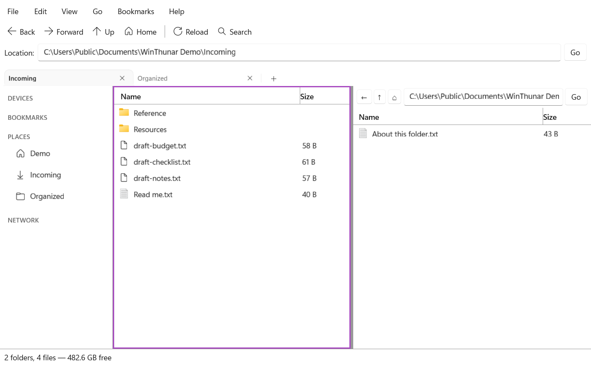
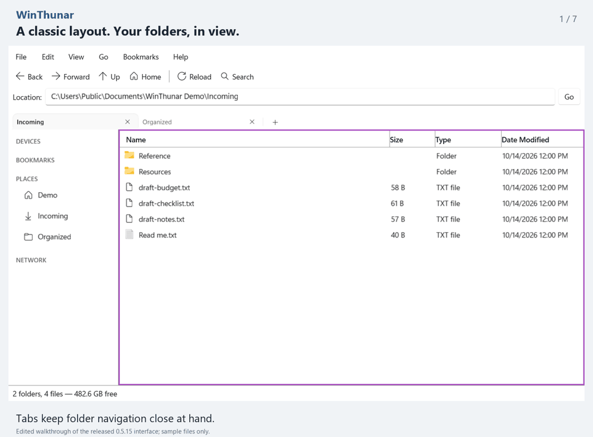

# WinThunar

**A classic file manager experience for Windows 11.**

WinThunar is a free, open-source Windows file manager inspired by Thunar. Browse with tabs
and split panes, preview bulk renames, and keep a PowerShell command panel beside your files.
It is an independent, clean-room implementation built with C#, .NET 10, and WinUI 3,
released under the MIT License. It is not an official Thunar or Xfce project and contains
no code copied from Thunar.

**[Download for Windows 11 (MSI)](https://github.com/TheTriumphantFox/WinThunar/releases/latest/download/WinThunar.App-win.msi)**
&nbsp;|&nbsp; [Portable ZIP](https://github.com/TheTriumphantFox/WinThunar/releases/latest/download/WinThunar.App-win-Portable.zip)
&nbsp;|&nbsp; [Release notes and all downloads](https://github.com/TheTriumphantFox/WinThunar/releases/latest)

Windows 11, x64. No separate .NET installation required. Installed copies support automatic
updates; portable copies are updated manually.

[](docs/media/winthunar-demo.mp4)

### Why try WinThunar?

- **Keep folders in view.** Tabs and split panes give each folder its own navigation history.
- **Organize names before moving files.** Bulk rename shows a preview before you apply changes.
- **Use a familiar layout.** Classic menus, a location bar, bookmarks, and a PowerShell panel
  keep common tools close to your files.

**[Watch the 25-second demo (MP4)](docs/media/winthunar-demo.mp4)**
or [open the animated walkthrough (GIF)](docs/media/winthunar-demo.gif).
The demo uses sample files and the released 0.5.0 interface.

<details>
<summary>Play the animated walkthrough here</summary>



</details>

### Help improve it

Try a few sample folders and tell us what makes everyday file management easier or harder.
[Share first-tester feedback](https://github.com/TheTriumphantFox/WinThunar/issues/new?template=tester-feedback.yml),
or [report a bug or request a feature](https://github.com/TheTriumphantFox/WinThunar/issues).
Useful reports include the WinThunar version, steps to reproduce, and what you expected.
Please remove personal paths and filenames from screenshots and logs before sharing them.

WinThunar is under active development. Transfer Undo includes Replace and directory Merge in 0.5.3,
while operations handed to Windows are outside its Undo history. History is window-local and is
not crash-atomic across multiple items. See the installation and Windows
integration notes below before choosing it as your default file manager.

## Release and source status

The latest published application release is **[0.5.8](https://github.com/TheTriumphantFox/WinThunar/releases/tag/v0.5.8)**
(22 October 2026), from source `b8cf52a` (PRs #21 and #22). Its changes are merged into `main`, and the GitHub updater feed
offers 0.5.8 to installed copies. Use **Help > Check for Updates...** to check immediately;
portable copies are updated manually. Documentation and website updates alone do not update the app.
See the [0.5.8 release notes](docs/RELEASE-0.5.8.md) for verification and remaining limits.
The version string alone does not establish that a local build matches published binaries.

Release **0.5.8** adds safer MSI repair and uninstall retention for newly built
installers. It does not replace an older MSI already cached on an installed machine; see the
[0.5.8 release notes](docs/RELEASE-0.5.8.md) for the migration and verification limits.

Release **0.5.7** fixes lost tabs after closing multiple windows by saving the closing window's
own session before an update applies. It passed 171 service tests (one skipped), 67 desktop checks,
two restart checks, and four isolated updater scenarios. Installations made with its older MSI
retain mixed-payload repair and settings-removal risks; read the
[installer findings](docs/RELEASE-0.5.7.md#verification-and-limits) before repair or uninstall.

Release **0.5.6** adds **System / Light / Dark** under **Edit > Preferences > Display > Theme**.
Apply updates all windows, native title bars, and WinThunar dialogs. The choice survives restart;
Cancel preserves it, and separate appearance settings prevent another window from overwriting it.

Release **0.5.5** adds updater error handling, an Interrupted Transfers
review/retry view, conservative recovery for unavailable storage, text-content search, This PC
filesystem search, read-only text/PDF previews with page navigation, and explicit `index:true`
Windows Search queries with coverage warnings. Disposable tests cover real disk-full after
main-stream writes and owned loopback-SMB interruption. It includes the unpublished 0.5.4 candidate.
See the [reliability milestone](docs/RELIABILITY-MILESTONE.md) for results and limits.

### Daily-default improvements in 0.5.3

- Transfer Undo/Redo includes Replace and directory Merge. Displaced items and exact Redo data
  are retained until the window's ten-action history expires; history still does not survive restart.
- Native copy, stream checks, and Undo handle long Windows paths. Disposable NTFS VHD tests verify
  cross-volume history and real disk-full allocation failures; physical removal and SMB interruption remain open.
- Search combines words, quoted names, wildcards, file types, modified dates, and sizes:
  `name:"annual report" type:pdf modified:last7days size:>1MB`.
- The interface follows Windows light/dark settings and uses system resources in the command panel,
  preview text, and drop highlight. Full screen-reader and contrast-theme review remains open.
- Folder enumeration checks cancellation between entries; filename search streams directory entries;
  selection totals use the listing's metadata rather than reopening selected paths.

## Foundation features retained from 0.5.0

- Classic menu, toolbar, location bar, side pane, detail view, and status bar
- Places, detected drives, a This PC drive overview (Up from a drive root), and OneDrive when signed in
- Real directory enumeration
- Back, Forward, Up, Home, Refresh, direct-path navigation, and folder opening
- Multiple selection and selection totals
- Thunar-style hidden-file filtering with `View > Show Hidden Files` and `Ctrl+H`
- Create folders and blank documents
- Rename and Thunar-style duplicate naming (`name (copy 1)`)
- Windows clipboard Cut, Copy, and Paste for files and folders
- Replace, Skip, Rename, or Cancel Remaining conflict decisions
- Delete moves to the Windows Recycle Bin; `Shift+Delete` requires permanent-delete confirmation
- Destination-side staged copies and rollback-safe replacement, so a failed incoming transfer cannot destroy the existing item
- Native Windows cross-volume copies that preserve file attributes, security metadata, extended attributes, and NTFS alternate data streams
- Sequential transfer queue with byte progress, throughput, ETA, queued-job count, and active-job cancellation
- Persistent recovery records for interrupted staged copies and replacements
- Ten-action Undo/Redo history for create, template/archive creation, rename, ordinary copy, move, and duplicate operations, guarded by destination-state verification
- Drag-and-drop into the current folder or a visible child folder
- Thunar-style drop rules: move on the same volume, copy across volumes, `Ctrl` forces copy, and `Shift` forces move
- Detailed, icon, and compact folder views (`Ctrl+2`, `Ctrl+1`, and `Ctrl+3`)
- Browser tabs with `Ctrl+T`, `Ctrl+W`, and independent Back/Forward history
- Split-pane browsing (`F3`) with an independent path, history, selection, and file-command target
- Persistent custom bookmarks and restart restoration for tabs, selected tab, folders, split state, view mode, and hidden-file preference
- Recursive active-pane search (`Ctrl+F`) with live batched results, query cancellation, hidden-file filtering, and safe junction handling
- Windows shell icons and content thumbnails in all folder views
- Live folder monitoring plus free-space reporting in the status bar
- Sortable and drag-resizable Name, Size, Type, and Date columns; configurable column visibility; persistent zoom and folders-first ordering
- Shortcuts and expandable tree side-pane modes
- Renameable, reorderable persistent bookmarks
- Pathbar and editable-toolbar location selector styles
- Native Windows Properties and Open With dialogs, new windows, and Open in New Tab
- The full Windows shell context menu, including third-party extensions and Send To, from `Show More Options` or Shift+right-click
- Create-from-Templates, symbolic links, select-by-pattern, and invert-selection commands
- Previewed, collision-safe bulk rename with grouped Undo/Redo
- Preferences for thumbnails, sorting, recursive search, trash confirmation, tab restoration, and default view
- In-app Windows Recycle Bin browsing, conflict-safe Restore, confirmed Empty Trash, mapped network locations, direct UNC connections, terminal launch, and removable-drive eject
- Customizable toolbar visibility and persistent alternate keyboard shortcuts
- Optional image-preview side pane, single-click activation, and per-folder view/zoom/sort memory
- Integrated PowerShell command panel (`F4`) that follows the active folder without covering the file list
- Manifest-based plugin discovery from bundled and per-user plugin folders, with validation diagnostics and enable/disable controls
- Selection-aware custom actions with file patterns, file/folder targeting, confirmation prompts, and argument-list execution without a command shell
- Atomic, junction-safe bundled archive create/extract, media-tag editing, Git status/diff/log, and Windows sharing-management integrations

## Desktop integration and accessibility in 0.5.3

These additions are included in 0.5.3. Notification availability and manual accessibility
verification remain subject to the limits below.

The taskbar jump list offers **New window**, **Home**, and **Downloads**. When a transfer finishes
while its window is in the background, WinThunar sends a local Windows notification; selecting it
opens the destination folder. If Windows notifications are unavailable or disabled, the in-app
status and error dialogs continue to report the outcome.

Git repositories show status badges in all three primary-pane layouts and the right-side
detailed list. Badges are not populated in search results or virtual locations such as Trash. The badges are
`✓` clean, `M` modified, `+` added, `−` deleted, `R` renamed, `?` untracked, `·` ignored, and `!`
conflicted. Folder badges summarize their descendants. Git is optional; queries run in the
background, refresh on navigation and every ten seconds, do not write the index, and disable
repository fsmonitor commands. Tooltips and accessible item names include the status text.

Use **F6 / Shift+F6** to move between tabs, location, side pane, file panes, and the visible
command input; **Ctrl+Tab / Ctrl+Shift+Tab** switches folder tabs. Focus a column divider and
use **Left / Right** to resize it. Keyboard focus selects the active split pane. The interface
exposes file metadata and Git status to accessibility tools. Most browser chrome uses system
color resources, but fixed colors remain in parts of the interface; high-contrast behavior
and screen-reader use still need manual verification. See the
[accessibility status](docs/ACCESSIBILITY.md) for implemented support and remaining checks.

## Installing

Download `WinThunar.App-win.msi` from GitHub Releases (local release builds name it
`WinThunar-<version>-win-x64.msi`). The target Windows 11 computer does not need a separate
.NET installation. The installer asks:

- **Just me or everyone.** Just me installs to `%LOCALAPPDATA%\WinThunar.App` without asking for
  administrator permission. Everyone installs to `C:\Program Files\WinThunar.App` for all accounts
  and needs administrator permission.
- **Which shortcuts to create:** a desktop shortcut, a Start menu shortcut, both, or neither.

WinThunar can be removed from Settings > Apps > Installed apps. For a scripted install, pass
`DESKTOPSHORTCUT=""` or `STARTMENUSHORTCUT=""` to `msiexec` to skip a shortcut.

Uninstalling removes the program and, if this copy was registered with Explorer, its "Open in
WinThunar" and default-file-manager settings. Your settings, bookmarks, session, and personal
plugins in `%LOCALAPPDATA%\WinThunar` are kept.

The portable ZIP is still available for running WinThunar without installing it.

## Updating

The installed WinThunar checks GitHub Releases for a new version once a day, starting shortly
after launch. A new version downloads in the background, usually as a small delta, and installs
after you close the last WinThunar window. An "Update ready" bar offers **Restart Now** to install
it straight away; that button waits until running transfers finish or are cancelled. When WinThunar
is installed for everyone, installing an update needs administrator permission, so it never installs
on close: the bar's **Install Now** button asks for permission instead. Use
`Help > Check for Updates...` to check on demand, and `Edit > Preferences > Updates` to turn
automatic checks off. Portable copies do not update themselves.

## Using WinThunar as the default file manager

`Edit > Preferences > Windows Integration` can add "Open in WinThunar" to Explorer's folder menu
and make WinThunar the handler for opening folders and drives. Both settings write only to your
own account's registry (`HKCU\Software\Classes`), record any value they replace, and restore it
when turned off. They are available in the installed and portable builds; MSIX packages cannot register shell
handlers this way.

The same changes can be scripted, and `--unregister-shell` is the recovery path if WinThunar
cannot start:

```powershell
.\WinThunar.exe --register-shell      # "Open in WinThunar" only
.\WinThunar.exe --register-default    # also open folders and drives in WinThunar
.\WinThunar.exe --unregister-shell    # undo both
```

Turn the setting off before moving or deleting the portable folder; the installed copy does this
when it is uninstalled. If the registered copy has
already been moved, launching WinThunar from its new location repairs the registration.

WinThunar accepts a folder or file path, `file:` URIs, and Explorer-style `/select,<path>`,
`/root,<path>`, `/n`, and `/e` switches. A second launch opens a new window in the running
process. Windows still opens Explorer for Win+E and for apps that call
`SHOpenFolderAndSelectItems` directly.

When WinThunar is denied access (for example in `Program Files`), it offers to let the Windows copy
engine finish the copy, move, trash, delete, new-folder, or rename, which asks for administrator
permission itself. In **release 0.5.0**, directory links and junctions are offered to the Windows
copy engine after confirmation; that fallback can follow the linked folder's contents as Explorer
does. Do not treat it as a link-preserving copy.

Release **0.5.3** preserves supported symbolic links and NTFS junctions as links without
traversing their targets, including during replacement and recovery. Copying symbolic links still
requires Windows Developer Mode or the symbolic-link privilege; unsupported link types can be
offered to Windows after confirmation. Archive creation continues to reject directory links.

Operations finished by Windows are outside WinThunar's Undo history. Native replacement and merge
transfers retain displaced content for Undo in 0.5.3; the ten-action history remains window-local.
See [file-operation behavior](docs/FILE-OPERATIONS.md) for the full scope and limitations.

## Build

Use Windows 11 with the .NET 10 SDK and Windows SDK build tools required by
`WinThunar.csproj` (the target framework is `net10.0-windows10.0.26100.0`). The commands
below target x64. Project platform entries for x86 and ARM64 do not imply downloadable
releases for those architectures.

```powershell
dotnet restore .\WinThunar.csproj -r win-x64
dotnet build .\WinThunar.csproj --configuration Debug -p:Platform=x64 --no-restore
dotnet run --project .\WinThunar.csproj --configuration Debug -p:Platform=x64
```

Run the isolated file-operation and browser-state tests:

```powershell
dotnet test .\tests\WinThunar.FileOps.Tests\WinThunar.FileOps.Tests.csproj --configuration Release
```

The source includes an isolated storage-failure and process-termination harness:

```powershell
powershell.exe -NoProfile -ExecutionPolicy Bypass -File .\scripts\Test-FileOperationsStress.ps1
```

It injects native copy errors and terminates its own test workers. The JSON report separates those
checks from optional real cross-volume tests and skipped physical-storage tests. See the
[stress-harness scope and results](docs/FILE-OPERATIONS-STRESS.md).

The source also includes an isolated desktop smoke build. Its harness is excluded from normal
application packages; it does not restore or save your normal session:

```powershell
powershell.exe -NoProfile -ExecutionPolicy Bypass -File .\scripts\Test-DesktopSmoke.ps1
```

The script writes a JSON report and rendered PNGs to a new temporary folder. The test-only
code is excluded from normal builds. The relative-symbolic-link unit test explicitly skips
when the Windows account lacks permission to create symbolic links.

Developer Mode must be enabled in Windows Settings to register and launch the development package.

## Windows release

Install the Velopack packaging tool once:

```powershell
dotnet tool install -g vpk --version 1.2.161
```

Build a release from the main checkout; this example uses 0.5.8:

```powershell
powershell.exe -NoProfile -ExecutionPolicy Bypass -File .\scripts\Publish-Release.ps1 -Version 0.5.8
```

For a new release, choose an unused version and update all four version locations before
building. The script refuses existing output paths. It writes a self-contained x64 folder,
a versioned ZIP and MSI, SHA-256 checksum files, and Velopack distribution packages beneath
`artifacts/`. **Never delete `artifacts/installer`: later versions need its earlier packages
to build delta updates.**

A build reaches installed users only after its Velopack packages are published to GitHub
Releases. See [building and publishing releases](docs/RELEASES.md) for the version checklist,
output filenames, upload command, and update-feed testing.

Bundled plugin manifests live beside the executable in `Plugins`. Personal manifests and
custom actions live in `%LOCALAPPDATA%\WinThunar\Plugins`, so reinstalling or replacing the
app does not overwrite them.

## Documentation

- [Browser views, tabs, split panes, and preferences](docs/BROWSER-WORKSPACE.md)
- [Search behavior and limits](docs/SEARCH.md)
- [File operations, Undo, and recovery](docs/FILE-OPERATIONS.md)
- [Storage-failure and process-termination checks](docs/FILE-OPERATIONS-STRESS.md)
- [Released features, unreleased work, and remaining gaps](docs/ROADMAP.md)
- [Accessibility status and verification limits](docs/ACCESSIBILITY.md)
- [Building, packaging, and publishing releases](docs/RELEASES.md)
- [Launch copy and promotional media](docs/PROMOTION.md)
- [First tester workflow and launch status](docs/LAUNCH.md)

## Icon

WinThunar's icon is an original design (a folder with a lightning bolt) and is covered by the
project's MIT License. It is drawn by `scripts\New-AppIcons.ps1`, which writes `Assets\AppIcon.ico`
and the MSIX logo images; change the shapes there and re-run it rather than editing the images.

## License

WinThunar is available under the [MIT License](LICENSE).
